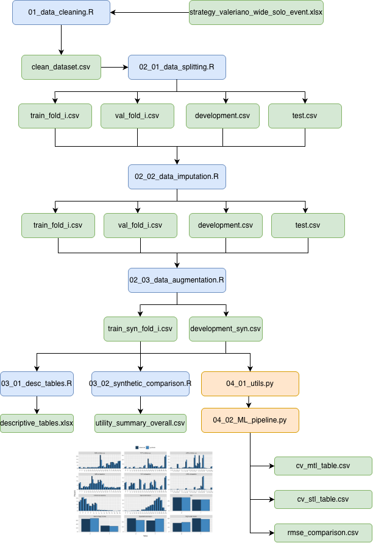
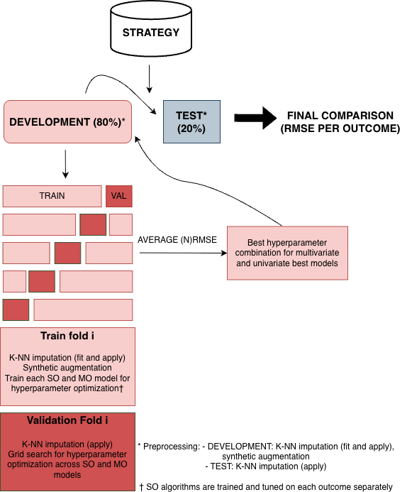

# code for "Simultaneous prediction of multiple functional outcomes in post-stroke rehabilitation using Machine Learning techniques"

Repository for the code of my master's thesis project.

## Flowchart of the scripts

## Machine Learning pipeline

